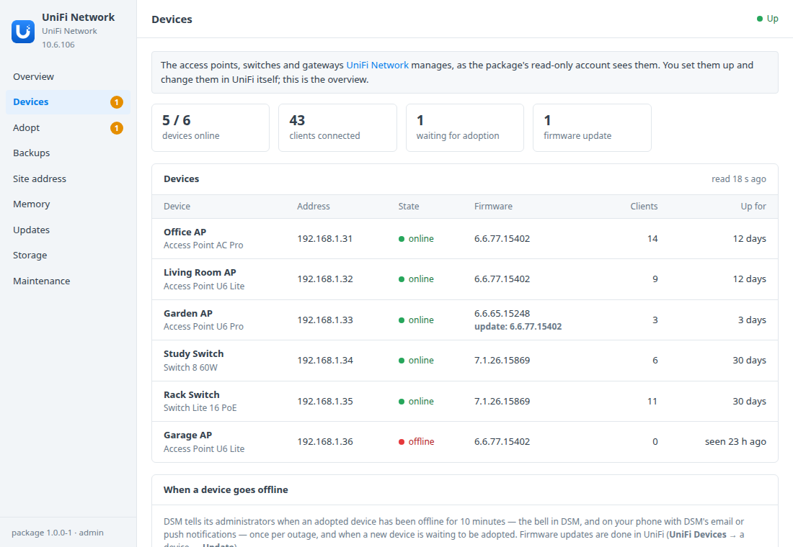
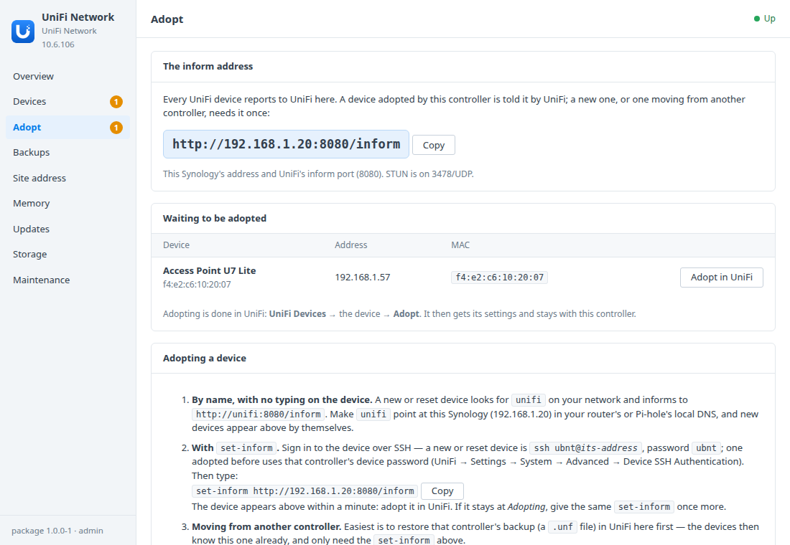
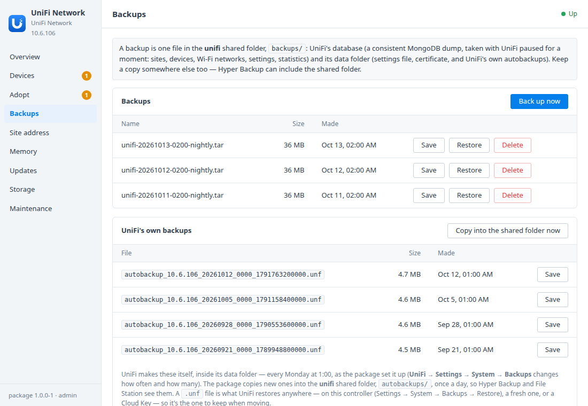
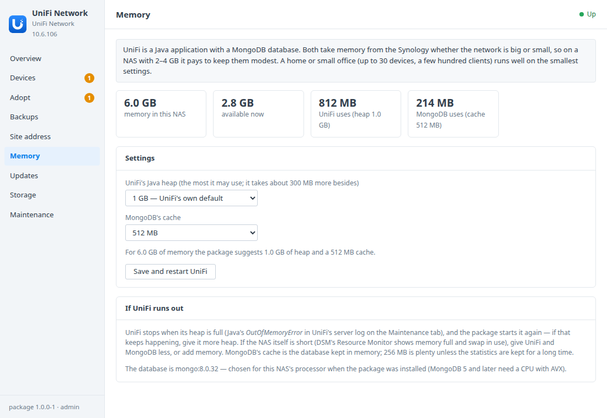

# UniFi Network for Synology DSM

A DSM 7 package that installs the
[UniFi Network Application](https://ui.com/download/releases/network-server) —
the controller for UniFi access points, switches and gateways — in Container
Manager, with MongoDB. A DSM window looks after:
- your administrator, made at the first start (UniFi's setup wizard is done for you);
- your devices, their firmware and clients;
- adopting new ones, and the address they inform to;
- UniFi's own backups beside consistent package backups;
- memory, for small NASes;
- updates.

**A community package.** It is not made, endorsed or supported by Ubiquiti or
Synology. UniFi is Ubiquiti's software, run here from
[linuxserver.io's image](https://docs.linuxserver.io/images/docker-unifi-network-application/).

Built on the [DSM app chassis](https://github.com/tombruton87/dsm-app-chassis).

## Download

### **[⬇ Download unifi.spk](https://github.com/tombruton87/unifi-dsm/releases/latest/download/unifi.spk)**

[](https://github.com/tombruton87/unifi-dsm/releases/latest)

That link always gives the newest version. Older ones are on the
[Releases](https://github.com/tombruton87/unifi-dsm/releases) page.

Install: Package Center → Manual Install → the `.spk` (DSM 7.2.1+; Container
Manager is installed first if missing). The wizard asks for:
- the NAS's address, the web port (8443 by default) and the time zone;
- your administrator's name and email, and the country (Wi-Fi rules follow it);
- HTTPS with UniFi's own certificate or DSM's;
- the device ports — inform (8080), STUN (3478/UDP) and discovery (10001/UDP).

Each port is checked on this Synology, and a free one is suggested if it's
taken. The first start downloads about 1.3 GB of images and takes a few
minutes. Your administrator's password is then shown once in the window.

**The inform port.** Devices report to UniFi on port 8080. A new device finds
UniFi by itself only there: it looks for the name `unifi` on your network. On
another port, every device has to be told with `set-inform` once. If you change
the port later, devices adopted on the old one need `set-inform` again. The
Adopt tab says this, and shows the exact command.

**Which MongoDB.** UniFi 10 supports MongoDB 3.6 to 8.0, and MongoDB 5 and
later need a processor with AVX. Many Synology models have a Celeron without
it (J4125, J3455, J4025…). The package checks the processor once, at the first
start:
- with AVX it uses MongoDB 8.0;
- without it, 4.4;
- on a Linux kernel of 6.19 or later, 7.0 — MongoDB 8.0 refuses to start
  there. DSM 7.2's kernel is much older; this only matters on other machines,
  such as the test box.

All are pinned. Patch releases follow the package; a major MongoDB upgrade is
never made by itself.

## What the DSM window adds

- **Devices**
  - Every adopted access point, switch and gateway: its model (from UniFi's own
    catalogue), address, state, firmware — with the version an update would
    bring — clients, and how long it's been up.
  - All sites, read by a read-only UniFi account the package makes
    (`dsm-package`).
  - A DSM notification when a device has been offline for 10 minutes (once per
    outage), and when a new one waits to be adopted.
- **Adopt**
  - The inform address, with a copy button.
  - Three ways to adopt: the `unifi` name in your router's or Pi-hole's local
    DNS, `set-inform` over SSH (the command, ready to paste), and restoring an
    old controller's backup first when moving.
  - The devices waiting for adoption.
  - **The address devices use** — UniFi's inform host override, which the
    package sets for you; inside Container Manager UniFi only knows its
    internal address.
  - **Ports:** inform, STUN, discovery and the guest portal. Each is refused if
    something else on the Synology has it, and DSM's firewall list follows.
- **Backups**
  - The package's backups, nightly or on demand, with restore: a MongoDB dump
    and UniFi's data folder. UniFi is paused (not stopped) for the few seconds
    the copy takes, so the two match.
  - **UniFi's own backups** (`.unf` autobackups): listed, copied daily into the
    shared folder's `autobackups/` for Hyper Backup and File Station, and
    downloadable. A `.unf` is what any UniFi controller restores.
- **Memory** — Java's heap (384 MB to 3 GB) and MongoDB's cache (256 MB to
  2 GB), with a suggestion for this NAS's memory and what each container uses
  now. The first start picks small settings on a 2 or 4 GB NAS.
- **Updates** — UniFi stays at a tested linuxserver.io release. The window
  finds newer ones on GitHub and ghcr.io, and moves to one when you press
  Update, after a backup.
- **Site address, storage, maintenance**
  - The address, and HTTPS with DSM's certificate — renewals are picked up
    daily — or behind DSM's reverse proxy.
  - A new password for any UniFi administrator, shown once, for when nobody can
    sign in.
  - A redacted support report, UniFi's server log, and removal of everything.

## Screenshots

| | |
|---|---|
|  |  |
|  |  |

## How it works

Two containers: `unifi-server` (UniFi, its data folder in the `unifi_config`
volume) and `unifi-db` (MongoDB, in `unifi_db`, on the project's own network
only). linuxserver.io's init script makes UniFi's own database user at the
first start.

UniFi tells devices which ports to use, so each port is the same on the NAS
and in the container. The package writes them, the database address and the
inform address into UniFi's `system.properties` at every start. Other lines in
that file are kept.

- **The first start** goes through the calls UniFi's setup wizard makes:
  - your administrator (`add-default-admin`);
  - the controller's name and the inform host override (your NAS's address);
  - country, time zone and device SSH credentials;
  - autobackups on, weekly (UniFi's own default is monthly), then *installed*.
  The read-only `dsm-package` account is made in the same session. Its password
  is in the root-only `.env`; your password isn't kept anywhere.
- **The window reads** UniFi's API as `dsm-package`, which can't change
  anything.
- **The few writes** that need more go to UniFi's MongoDB directly, the way
  Ubiquiti's own recovery steps do:
  - a new password (a SHA-512 crypt hash in `admin.x_shadow`);
  - the inform host (with UniFi stopped for a minute).
  If `dsm-package` can't sign in — say, after restoring another install's
  backup — its password is put back the same way.
- **HTTPS with DSM's certificate** imports DSM's system-default certificate
  into UniFi's Java keystore.
- **The guest portal's ports** are only published while it's on. Otherwise they
  go to a random port on 127.0.0.1.
- **Not published:**
  - 1900/UDP: UniFi announcing itself; broadcasts don't reach Container
    Manager's network;
  - 6789: the old mobile speed test;
  - 5514/UDP: remote syslog.

The image comes from lscr.io/ghcr.io, which the chassis's Docker Hub update
check can't read. The package therefore looks for linuxserver.io releases
itself. It updates by its own path, which removes only the old UniFi image —
never other unused images on the NAS.

**What needs real hardware.** The controller side is tested end to end, on
Linux with Docker: setup, accounts, ports, backups, restore, updates and
HTTPS. That box's kernel meant MongoDB 7.0 there, not 8.0. Adopting a real device, its state and clients, and the
offline/waiting notifications on a real DSM haven't been tested with hardware
yet.

## Layout

```
chassis/          the DSM app chassis (git submodule)
package.conf      name, title, services, volumes, images, port, texts
app/compose.yaml  UniFi and MongoDB
setup/app.sh      the hooks: first-run setup, the read-only account, ports, inform host, memory, backups, updates
ui/               Devices, Adopt and Memory tabs, UniFi's backups, HTTPS, administrators; CGI validation
wizard/           the UniFi pages of the install wizard (administrator, country, HTTPS, device ports)
tests/            steps for the chassis harness
```

Test: `E2E_PORT=8444 chassis/tests/e2e.sh . up && chassis/tests/e2e.sh . act`
on any Linux box with Docker. `tests/e2e-app.sh` uses inform 8081 and
discovery 11001/UDP; change them there if those are taken.

Release: bump `VERSION`, add the changes to `CHANGELOG.md`, build, then attach
the package twice, under its versioned name and as `unifi.spk`:

```bash
cp dist/unifi-X.Y.Z-1.spk /tmp/unifi.spk
gh release create vX.Y.Z dist/unifi-X.Y.Z-1.spk /tmp/unifi.spk
```

Build: `chassis/build.sh . N`.

## Credits

The icon is UniFi's own U mark on a DSM-style tile in UniFi's blue, used only to
show which app the package installs. UniFi and Ubiquiti are trademarks of
Ubiquiti Inc.; the UniFi Network Application is Ubiquiti's software, under
Ubiquiti's licence terms. The container image is linuxserver.io's. This package
is a community project, not affiliated with Ubiquiti, linuxserver.io or
Synology.
